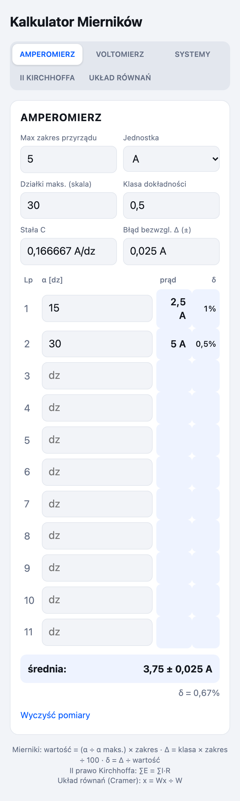
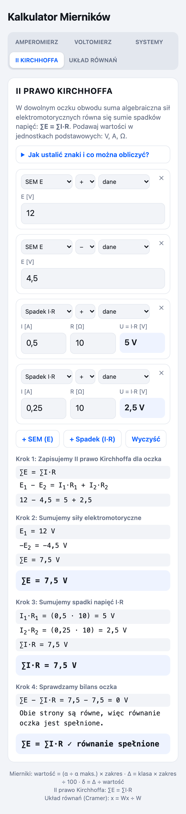
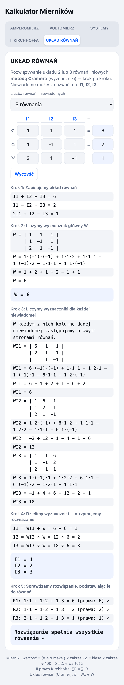

# Kalkulator Mierników

Prosta aplikacja webowa (PWA) do obliczeń na lekcjach elektrotechniki i miernictwa:
wskazania **amperomierza** i **woltomierza**, **niepewności pomiarowe**, przeliczanie
**systemów liczbowych**, **II prawo Kirchhoffa** oraz rozwiązywanie **układów równań**
metodą Cramera — wszystko z rozwiązaniem krok po kroku.

## 🔗 Aplikacja online

### **https://sigpath.github.io/Kalkulator-Miernikow/**

Nie wymaga instalacji ani logowania — wystarczy otworzyć link w przeglądarce.
Można ją też zainstalować jak zwykłą aplikację i korzystać **offline**:

* **Android / Chrome** — przycisk „Zainstaluj” na górze strony (albo menu ⋮ → „Zainstaluj aplikację”).
* **iPhone / iPad (Safari)** — przycisk **Udostępnij** → **Do ekranu początkowego**.
* **Komputer (Chrome/Edge)** — ikona instalacji w pasku adresu.

Po pierwszym otwarciu aplikacja działa bez internetu (service worker cache'uje wszystkie pliki).

## Zrzuty ekranu

| Amperomierz — wskazania i niepewności | II prawo Kirchhoffa — rozwiązanie krok po kroku |
|---|---|
|  |  |

## Funkcje

### 1. Amperomierz i woltomierz

Dla podanego zakresu, liczby działek i klasy dokładności przyrządu obliczane są wskazania
dla kolejnych pomiarów oraz błąd bezwzględny i względny każdego z nich.

| Wielkość | Wzór |
|---|---|
| Stała przyrządu | `C = zakres / działki maks.` |
| Wartość mierzona | `wartość = α · C = (α / α maks.) · zakres` |
| Błąd bezwzględny | `Δ = klasa · zakres / 100` |
| Błąd względny | `δ = Δ / wartość · 100%` |

Aplikacja liczy też **średnią** wszystkich pomiarów (z niepewnością `± Δ`) i jej błąd względny.
Zakładki amperomierza i woltomierza mają niezależne dane i jednostki (A/mA, V/mV).

### 2. Systemy liczbowe

Przeliczanie między systemem **dwójkowym, ósemkowym, dziesiętnym i szesnastkowym**
z pełnym zapisem obliczeń:

* metoda skrótowa dla potęg dwójki (grupowanie bitów po 3 lub 4),
* metoda ogólna: wagi pozycji (system → dziesiętny) i dzielenie z resztą (dziesiętny → system),
* walidacja cyfr (np. odrzucenie „2” w systemie dwójkowym) i przycisk zamiany systemów.

### 3. II prawo Kirchhoffa

Dla dowolnego oczka obwodu: **∑E = ∑I·R** — suma algebraiczna sił elektromotorycznych równa się
sumie spadków napięć.

* Dodajesz kolejne elementy oczka: **SEM E** albo **spadek I·R** i ustawiasz znak każdego z nich.
* Program liczy `∑E`, `∑I·R` i sprawdza bilans oczka (z tolerancją na błędy zaokrągleń).
* Zamiast sprawdzać — możesz **obliczyć brakującą wielkość**: przy wybranej wielkości ustaw
  „szukane” i zostaw jej pole puste. Program rozwiąże równanie i pokaże całe wyprowadzenie.

Rozwiązywane równania (σ to znak elementu: `+1` lub `−1`):

| Szukane | Wzór |
|---|---|
| SEM | `E = (∑I·R − ∑E_pozostałe) / σ` |
| Prąd | `I = (∑E − ∑I·R_pozostałe) / (σ · R)` |
| Opór | `R = (∑E − ∑I·R_pozostałe) / (σ · I)` |

#### Jak ustalić znaki

Obiegamy oczko w wybranym kierunku (np. zgodnie z ruchem wskazówek zegara) i porównujemy go
z kierunkiem prądu i SEM:

* **SEM E** — znak „+”, gdy przechodzimy przez źródło od bieguna „−” do „+”, czyli SEM działa
  zgodnie z obiegiem; znak „−” w przeciwnym wypadku.
* **Spadek I·R** — znak „+”, gdy prąd płynie zgodnie z kierunkiem obiegu; znak „−”, gdy przeciwnie.

Wynik ujemny nie jest błędem — oznacza, że przy przyjętym kierunku obiegu dana wielkość ma
zwrot przeciwny do założonego. Aplikacja wypisuje wtedy odpowiednie ostrzeżenie.

### 4. Układ równań — metoda Cramera

Do zadań z praw Kirchhoffa potrzebny jest jeszcze **układ równań**. Ta zakładka rozwiązuje
układ **2 lub 3 równań liniowych** metodą wyznaczników (Cramera), pokazując cały tok obliczeń:

* wpisujesz współczynniki w macierzy — puste pole oznacza `0`,
* niewiadome możesz **nazwać** (np. `I1`, `I2`, `I3`) — nazwy pojawią się w zapisie i wyniku,
* program liczy wyznacznik główny `W` (reguła Sarrusa), wyznaczniki `Wx`, `Wy`, `Wz`,
  dzieli je i **sprawdza wynik**, podstawiając go z powrotem do równań,
* gdy `W = 0`, aplikacja wyjaśnia, że układ jest nieoznaczony albo sprzeczny (metoda Cramera
  nie daje wtedy wyniku).



Wzory, których używa:

| Krok | Wzór |
|---|---|
| Wyznacznik główny | `W = det(A)` (dla 3×3 reguła Sarrusa) |
| Wyznacznik niewiadomej | `Wx = det(A z kolumną x zastąpioną prawymi stronami)` |
| Rozwiązanie | `x = Wx / W` |

### Jak to połączyć w zadaniu z praw Kirchhoffa

1. W zakładce **II KIRCHHOFFA** zapisz równania kolejnych oczek (`∑E = ∑I·R`) i sprawdź znaki.
2. Równania prądowe dla węzłów (`I1 = I2 + I3`) zapisz od razu w postaci współczynników.
3. Wszystkie równania wpisz w zakładce **UKŁAD RÓWNAŃ**, nazwij niewiadome `I1`, `I2`, `I3`
   i odczytaj prądy wraz z pełnym rozwiązaniem.

### Zapamiętywanie danych

Każda zakładka zapisuje swoje dane w przeglądarce (`localStorage`), więc po zamknięciu
i ponownym otwarciu strona wraca do ostatniego stanu — łącznie z aktywną zakładką.

## Uruchomienie lokalne

Aplikacja nie ma żadnych zależności ani procesu budowania — to pojedynczy plik HTML.

```bash
git clone https://github.com/SigPath/Kalkulator-Miernikow.git
cd Kalkulator-Miernikow
```

Otwórz `index.html` w przeglądarce albo — żeby działał service worker i instalacja PWA —
uruchom dowolny serwer HTTP w katalogu projektu:

```bash
python3 -m http.server 8000
# następnie otwórz http://localhost:8000
```

## Struktura projektu

| Plik | Opis |
|---|---|
| `index.html` | cała aplikacja: interfejs, style i logika (HTML + CSS + JS w jednym pliku) |
| `sw.js` | service worker — cache plików i działanie offline (strategia network-first) |
| `manifest.webmanifest` | metadane PWA: nazwa, ikony, tryb `standalone` |
| `icon-192.png`, `icon-512.png` | ikony aplikacji (512 także jako `maskable`) |
| `icon-180.png` | ikona dla iOS (`apple-touch-icon`) |
| `screenshot-*.png` | zrzuty ekranu użyte w tym README (mierniki, Kirchhoff, układ równań) |
| `PODZAIŁKI_ET.xlsx` | arkusz, który był pierwowzorem zakładki amperomierza/woltomierza |

## Technikalia

* **Bez zależności** — czysty HTML/CSS/JS, bez frameworków, bez `package.json`, bez budowania.
* **Bez backendu** — wszystkie obliczenia wykonują się lokalnie w przeglądarce; dane nie są
  nigdzie wysyłane.
* **Dowolna precyzja** w zakładce systemów liczbowych dzięki `BigInt`.
* **Polski format liczb** — przecinek dziesiętny na wejściu i wyjściu.
* **Tryb ciemny** — automatycznie wg ustawień systemowych (`prefers-color-scheme`).
* **Responsywność** — układ mobilny; na wąskich ekranach zakładki zawijają się w dwie kolumny.

### Hosting (GitHub Pages)

Strona publikowana jest automatycznie z gałęzi `main` (katalog główny) przez GitHub Pages —
po każdym `git push` na `main` aktualizacja jest wdrażana w ciągu ok. minuty.

> Po zmianie plików warto podbić numer cache w `sw.js` (`const CACHE="mierniki-vN"`),
> żeby użytkownicy offline dostali nową wersję.
